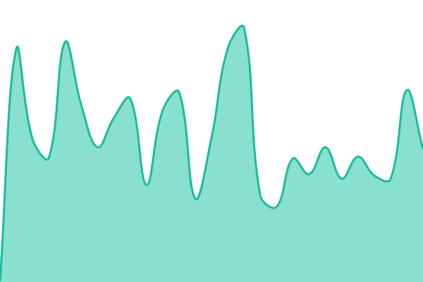
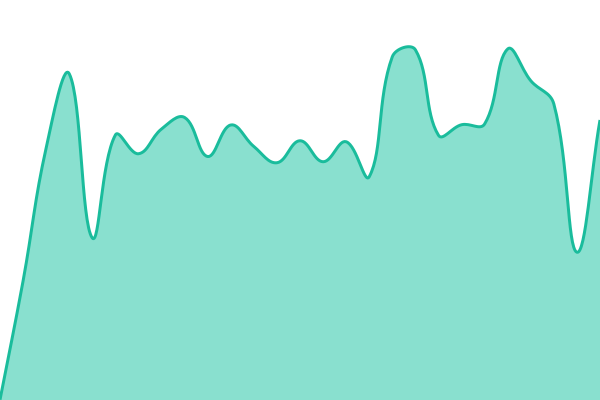

# Wanderlist Service Status

Independent availability monitoring for Wanderlist, powered by [Upptime](https://upptime.js.org).

Planned address: https://status.wanderlist.net

This repository is prepared for deployment. Scheduled monitoring and its public website
are not live until GitHub Actions, Pages, and the domain are configured.
See [SETUP.md](SETUP.md) for the remaining publishing steps.

## Monitored endpoints

- Website: public website availability.
- Blog: published-post API and its database read.
- Trip Data: public trip-template API and its database read.
- AI Connections: OAuth connection metadata availability.

These checks do not certify login, AI generation, payments, or notification delivery.

## Latest status

<!--start: status pages-->
<!-- This summary is generated by Upptime (https://github.com/upptime/upptime) -->
<!-- Do not edit this manually, your changes will be overwritten -->
<!-- prettier-ignore -->
| URL | Status | History | Response Time | Uptime |
| --- | ------ | ------- | ------------- | ------ |
|  [Wanderlist Website](https://www.wanderlist.net) | 🟩 Up | [website.yml](https://github.com/m2007b/wanderlist-status/commits/HEAD/history/website.yml) | 

 241ms
     
 | 

<a href="https://status.wanderlist.net/history/website">100.00%</a>
    

|  [Wanderlist Blog](https://www.wanderlist.net/api/blogs) | 🟩 Up | [blog.yml](https://github.com/m2007b/wanderlist-status/commits/HEAD/history/blog.yml) | 

 1023ms
     
 | 

<a href="https://status.wanderlist.net/history/blog">100.00%</a>
    

|  [Wanderlist Trip Data](https://www.wanderlist.net/api/trips/templates) | 🟩 Up | [trip-data.yml](https://github.com/m2007b/wanderlist-status/commits/HEAD/history/trip-data.yml) | 

 960ms
     
 | 

<a href="https://status.wanderlist.net/history/trip-data">100.00%</a>
    

|  [Wanderlist AI Connections](https://www.wanderlist.net/.well-known/oauth-authorization-server) | 🟩 Up | [ai-connections.yml](https://github.com/m2007b/wanderlist-status/commits/HEAD/history/ai-connections.yml) | 

 142ms
     
 | 

<a href="https://status.wanderlist.net/history/ai-connections">100.00%</a>
    

<!--end: status pages-->

## Validation

Run npm ci --ignore-scripts, then npm run check. Use npm run check:live for a one-time
read-only endpoint check. No application secrets are required.

## License

The Upptime template is MIT licensed; see [LICENSE](LICENSE).
